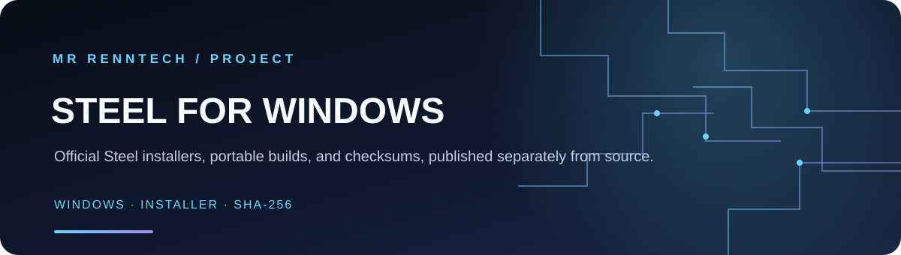

# Steel for Windows

Official installers, portable builds, and checksums for Steel. This repository
contains release files only; the source remains in the private
[Steel repository](https://github.com/MrRenntech/Steel).

## Latest stable release

**Steel 7.4.0** is the latest stable release. Download from the
[v7.4.0 release page](https://github.com/MrRenntech/Steel-Releases/releases/tag/v7.4.0):

- `Steel-Setup.exe` — Windows installer
- `Steel-Portable-Windows.zip` — portable application
- `SHA256SUMS.txt` — checksums for verifying the downloads

The 7.5.0 work is still in development and is not available as a stable
download. Follow the [Releases page](https://github.com/MrRenntech/Steel-Releases/releases)
for published builds.

## Verification

Compare the SHA-256 hash of a downloaded file with the matching entry in
`SHA256SUMS.txt`. The checksum detects file corruption or mismatch; it is not a
publisher digital signature. Installers may request Windows administrator
approval.

Steel is a privacy-first assistant that can work with local models and local
speech recognition. Optional online features are controlled in the app's
settings and may send the information needed for a user-requested request to
the selected service. Read the source repository's privacy notes before
enabling online providers.
