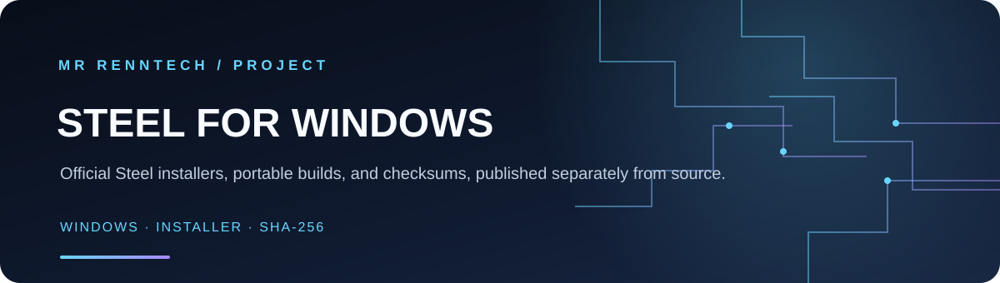

<h1 align="center">STEEL FOR WINDOWS</h1>

Official Steel installers, portable builds, and checksums, published separately from source.

Windows · Installer · SHA-256

---

This repository contains official compiled Windows releases of Steel.

## Downloads

Download the latest installer or portable ZIP from the [Releases page](https://github.com/MrRenntech/Steel-Releases/releases).

- **Steel-Setup.exe** — Windows installer
- **Steel-Portable-Windows.zip** — Portable application
- **SHA256SUMS.txt** — SHA-256 checksums for verifying downloads

The application source code is maintained privately in the [Steel source repository](https://github.com/MrRenntech/Steel).
